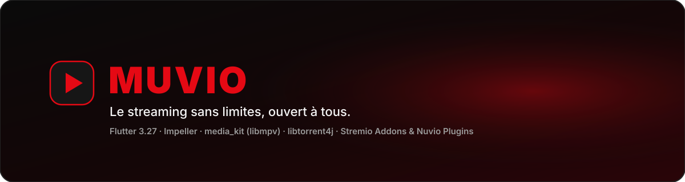
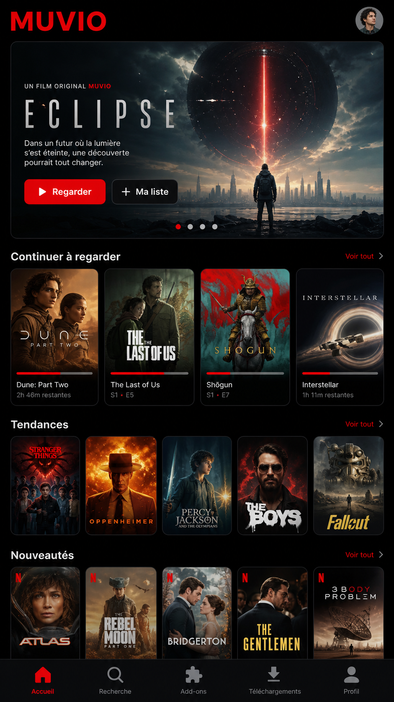
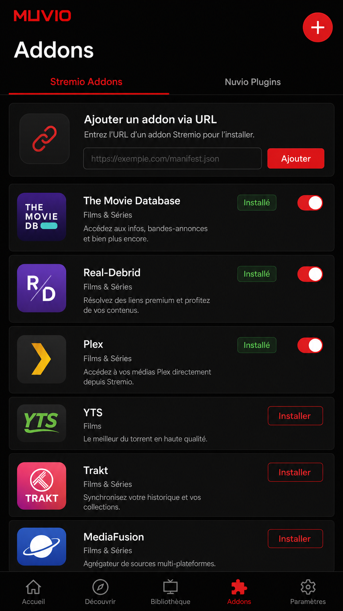
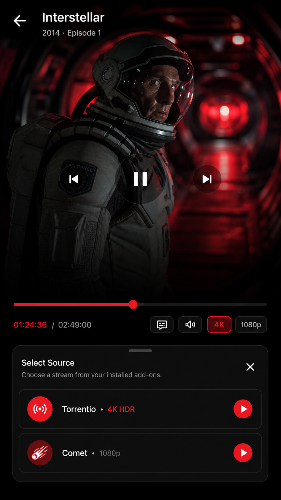
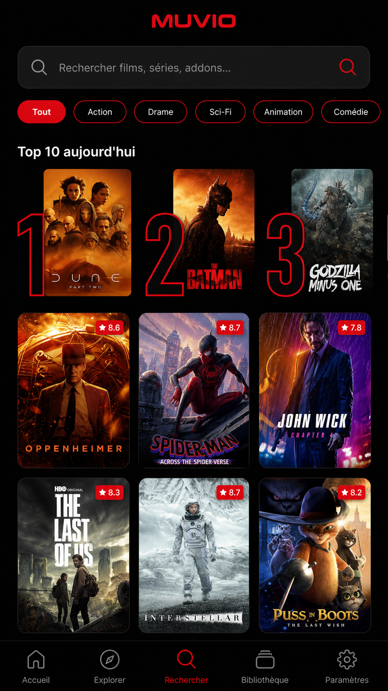
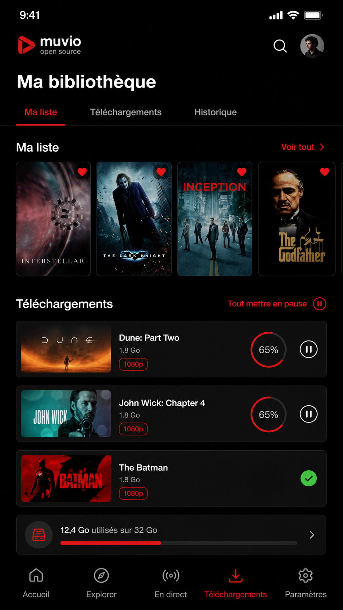
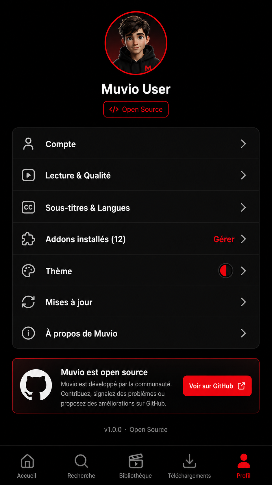
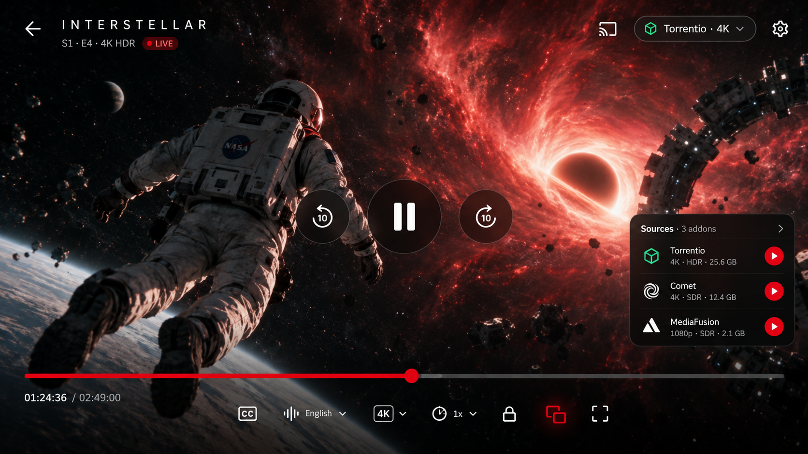

<div align="center">



<br />

# MUVIO

**Streaming open source compatible addons Stremio & plugins Nuvio**  
*« Le streaming sans limites, ouvert à tous. »*

[](https://github.com/iu468336-jpg/muvio/actions/workflows/build-apk.yml)
[](https://github.com/iu468336-jpg/muvio/releases/latest)
[](LICENSE)
[](CHANGELOG.md)

<br />

<a href="https://github.com/iu468336-jpg/muvio/releases/latest">
  
</a>

</div>

---

## Présentation

**Muvio** (`app.muvio.mobile`) est un lecteur et gestionnaire de médias Android natif ultra-fluide (60/120 fps avec moteur **Impeller**), conçu en **Flutter**, **Riverpod 2**, **Drift (SQLite)**, **media_kit (`libmpv`)** et **libtorrent4j + NanoHTTPD**.

- **Protocole officiel Stremio Addons & Nuvio Plugins** : installation en un clic par URL `https://.../manifest.json` avec aperçu du manifest, validation anti-SSRF et disjoncteur automatique (*circuit breaker*).
- **Lecture universelle haute performance** : décodage matériel 4K HDR / 1080p via `libmpv`, streaming torrent séquentiel immédiat (`127.0.0.1`), sous-titres externes/intégrés, Picture-in-Picture (PiP Android 8+) et reprise à la seconde exacte.
- **Respect total de la vie privée** : 100 % open source (MIT), zéro publicité, zéro analytics, zéro télémétrie, stockage chiffré Android Keystore pour vos clés Trakt / Real-Debrid.

---

## Captures d'écran (Les 7 Écrans)

| 1. Accueil | 2. Addons & Plugins | 3. Lecteur Portrait | 4. Recherche & Top 10 |
| :---: | :---: | :---: | :---: |
|  |  |  |  |

| 5. Bibliothèque & Téléchargements | 6. Profil & Paramètres | 7. Plein Écran Paysage 16:9 |
| :---: | :---: | :---: |
|  |  |  |

---

## Installation sur Android

1. Téléchargez le fichier APK correspondant à votre appareil depuis la page [**Releases**](https://github.com/iu468336-jpg/muvio/releases/latest) :
   - **`muvio-v1.0.0-arm64-v8a.apk`** *(Recommandé — 99 % des smartphones Android récents)*
   - `muvio-v1.0.0-armeabi-v7a.apk` *(Appareils 32-bit plus anciens)*
   - `muvio-v1.0.0-x86_64.apk` *(Émulateurs / ChromeOS / PC Android)*
2. Ouvrez le fichier `.apk` sur votre téléphone.
3. Si Android le demande, activez **« Autoriser l'installation d'applications issues de cette source »** (*Sources inconnues*).
4. Lancez **Muvio**, rendez-vous dans l'onglet **Addons** et activez ou ajoutez vos addons favoris via leur URL `manifest.json`.

---

## Compiler depuis les sources

```bash
git clone https://github.com/iu468336-jpg/muvio.git
cd muvio
flutter pub get
flutter gen-l10n
flutter analyze
flutter test --concurrency=1
flutter build apk --release --split-per-abi --tree-shake-icons
```

Documentation détaillée :
- [Architecture technique (`docs/ARCHITECTURE.md`)](docs/ARCHITECTURE.md)
- [Design System (`docs/DESIGN.md`)](docs/DESIGN.md)
- [Guide de contribution (`CONTRIBUTING.md`)](CONTRIBUTING.md)

---

## Contribuer

Les contributions de la communauté sont les bienvenues ! Consultez [`CONTRIBUTING.md`](CONTRIBUTING.md) et [`CODE_OF_CONDUCT.md`](CODE_OF_CONDUCT.md) avant d'ouvrir une Pull Request.

---

## Disclaimer légal

> **Important :** Muvio est strictement un lecteur multimédia et agrégateur de métadonnées open source neutre. **Muvio n'héberge, ne stocke, ne fournit et ne distribue aucun contenu vidéo ou audio.** L'application se contente de lire les flux fournis par les addons tiers que l'utilisateur choisit d'installer sous sa seule et entière responsabilité, dans le respect des lois en vigueur dans sa juridiction.

---

## Licence

Distribué sous licence [MIT](LICENSE).
